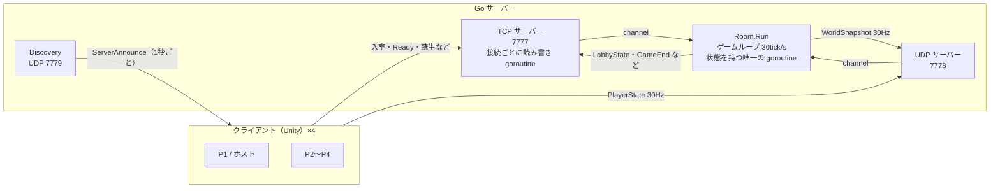

# misoten2026-server

4人協力TPSゲームの、LAN 対戦用ゲームサーバーです。Go の標準ライブラリだけで書いています。

展示会の会場で、ホストの PC がサーバーを起動し、ホスト自身を含む最大4台のクライアント（Unity）が接続して遊びます。

## 概要

- **担当**：チーム制作のゲームで、サーバー全体とクライアント（Unity）側の通信部分を担当しました。このリポジトリはそのうちサーバー部分です。
- **期間**：2026年9月〜（開発中）
- **規模**：Go 約3,600行（テスト 62件を含む）
- **技術**：Go 1.25（標準ライブラリのみ）、TCP / UDP、`log/slog`、`encoding/json`

### できること

- LAN 内のサーバーを UDP ブロードキャストで自動で見つける（IP の入力が要らない）
- 入室・ロビー・Ready・ステージ読み込み・ゲーム開始・結果までの進行管理
- プレイヤーと敵の位置を 30Hz で全員に配る
- 切断から30秒以内なら、同じ枠に戻ってゲームを続けられる（再接続）
- 蘇生・村の耐久値・武器合体地点の予約など、全員で結果を揃える必要があるルールの判定
- 勝敗の判定（ボス撃破・全員ダウン・村の耐久値0）

## 構成



| パス | 内容 |
| --- | --- |
| `cmd/server` | 起動、`config.json` の読み込み、ログ、親プロセスの監視 |
| `internal/net` | TCP フレーム、UDP ヘッダ、メッセージ定義、TCP/UDP サーバー、サーバー発見 |
| `internal/game` | ゲームループ（`Room`）、プレイヤー枠、敵・蘇生・村・武器・合体地点・勝敗 |
| `docs/protocol.md` | 通信プロトコルの仕様 |

## 設計で工夫した点

### ゲームの状態は1つの goroutine だけが触る

ゲームの状態を持つのは `Room.Run` の goroutine 1本だけです。TCP の読み取り（接続ごと）と UDP の受信は別の goroutine で行い、channel でゲームループに渡します。mutex を使わずにデータ競合を避けられ、ゲームのロジックを順番どおりに読める・テストできる形にしました。

### TCP と UDP の使い分け

- **TCP**：入室・Ready・ゲーム開始・蘇生の成立など、届かないと困るイベント
- **UDP**：30Hz で送り続ける位置などの状態。1パケット1200バイト以下、再送なし、古い `seq` は捨てる

UDP には 12 バイトの独自ヘッダ（magic・version・msgType・playerId・seq・token）を付けています。入室時に TCP で配ったトークンと一致しないパケットは捨てるので、別のプレイヤーになりすました送信を防げます。プレイヤーと敵を1つのパケットに入れると 1200 バイトを超えるため、スナップショットを分けて送っています。

### サーバー発見と、ホストからの自動起動

サーバーは自分の情報（名前・人数・状態）を UDP ブロードキャストで1秒ごとに流し、クライアントはそれを一覧に出します。会場で IP アドレスを打たずに入れるようにするためです。

また Unity のゲームを「ホスト」として起動すると、ゲームがこのサーバーを子プロセスとして立ち上げます。`-parentPid` を渡すと、ゲームが終了したときにサーバーも一緒に止まります。

### 判定をサーバーに置くもの・クライアントに任せるもの

すべてをサーバーで計算するのではなく、ずれると困るものだけをサーバーで判定しています。

| 判定 | 担当 | 理由 |
| --- | --- | --- |
| 蘇生の成否 | サーバー | 距離と経過時間を全員で揃えるため |
| 村の耐久値 | サーバー | 開始からの経過時間で求め、tick が遅れてもずれない |
| 合体地点の予約 | サーバー | 同時に押したとき、先に頼んだ1人だけに通すため |
| 勝敗 | サーバー | 全員に同じ結果を出すため |
| 敵の AI | 担当クライアント1台 | 物理と AI は Unity 側にあるため。担当はサーバーが決め、切断したら次の人に引き継ぐ |
| 自分の HP・攻撃の当たり | 各クライアント | 自分の操作の反応を遅らせないため |

### 再接続

TCP で3秒何も届かなければ切断とみなしますが、枠は30秒残します。`Reconnect` で戻ってきたら、そのときの段階（ロード中・ゲーム中・結果）に合わせて必要なメッセージと、武器・合体地点・ボス・村の状態を送り直します。

## 動かし方

Go 1.25 以上が必要です。

```powershell
# テスト
go test ./...

# ビルド（bin/ に misoten_server.exe と config.json を出力）
./build.ps1

# 起動（config.json は実行ファイルの隣 → カレントの順に探す）
./bin/misoten_server.exe
./bin/misoten_server.exe -config path/to/config.json
```

- ログは標準出力と `logs/server_YYYYMMDD_HHMMSS.log` に出ます。
- 初回起動時に Windows ファイアウォールの許可を求められたら、プライベートネットワークを許可してください。
- ポート・tick レート・人数・蘇生時間などは `config.json` で変えられます。

## テスト

`internal/game` と `internal/net` に 62 件のテストがあります。ゲームループは時刻と送信先を外から渡せるようにしてあり、ネットワークを使わずに入室・切断・再接続・蘇生・勝敗などの流れを確かめられます。

## 通信プロトコル

メッセージの一覧と通信の流れは [docs/protocol.md](docs/protocol.md) にまとめています。
